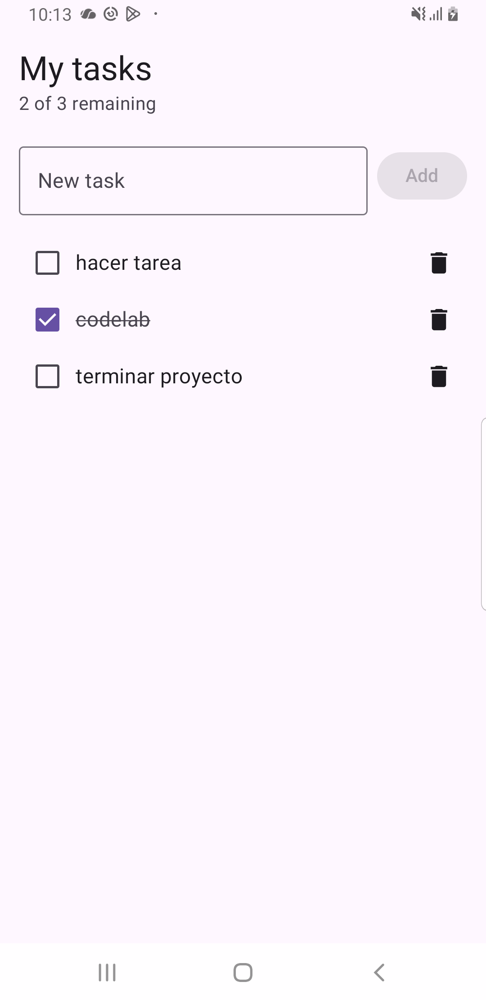
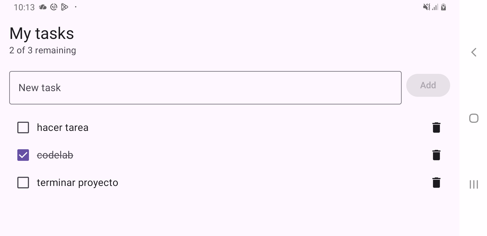

# Codelab: TODO con ViewModel y State

Entrega mediante README (opción A). Repositorio de entrega: [macusmarroquin93/TODOViewModel](https://github.com/macusmarroquin93/TODOViewModel). Proyecto base: [franzueto/TODOViewModel](https://github.com/franzueto/TODOViewModel). Guía seguida: [Improve the TODO app with ViewModel and State](codelab/index.html).

## ¿Qué se hizo?

Se modificó una aplicación de tareas hecha con Kotlin y Jetpack Compose. La app permite agregar tareas, marcarlas como completadas, eliminarlas y ver cuántas quedan pendientes.

El cambio principal fue separar la lógica de la pantalla usando un ViewModel y un repositorio.

## Cambios realizados

- `Todo`: representa una tarea.
- `TodoRepository`: guarda y actualiza la lista de tareas.
- `TodoUiState`: contiene los datos que muestra la pantalla.
- `TodoViewModel`: maneja las acciones del usuario y el estado.
- `TodoScreen`: muestra la interfaz y recibe las acciones.

Se trabajaron conceptos como ViewModel, StateFlow, estado de UI y separación de responsabilidades.

## Problema encontrado

Al principio, las tareas se borraban al girar el teléfono porque la versión instalada todavía guardaba la lista dentro de la pantalla.

Después de instalar la versión actualizada con ViewModel, las tareas y su estado de completado se conservaron al girar el dispositivo.

Las tareas se guardan en memoria; todavía no se utiliza una base de datos.

## Pruebas

El proyecto compiló correctamente y pasaron las cinco pruebas unitarias del codelab.

También se probó la app en un Samsung Galaxy Note8 y se verificó que las tareas se conservaran al cambiar de orientación.

## Capturas

### Pantalla vertical

### Pantalla horizontal

## Ejecutar el proyecto

1. Abrir el proyecto en Android Studio.
2. Sincronizar Gradle.
3. Conectar un teléfono o iniciar un emulador.
4. Presionar Run.

Se necesita Android SDK 36 y JDK 17 para compilar.

